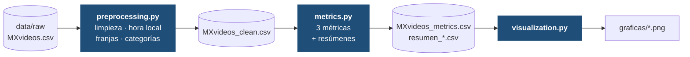
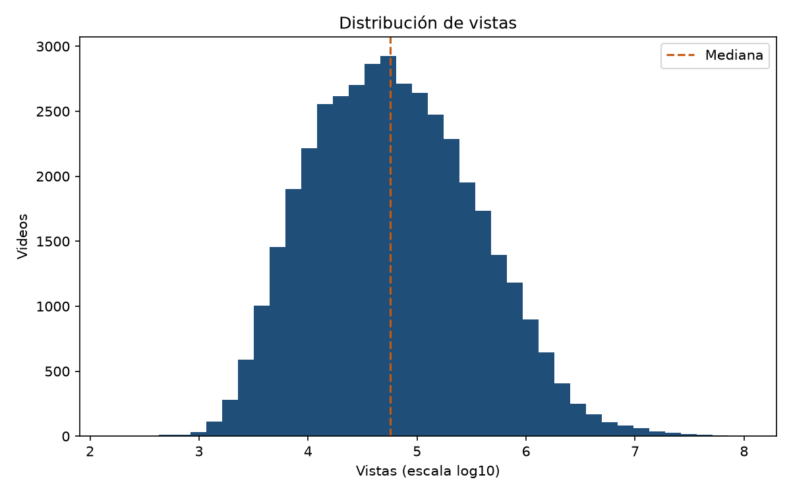
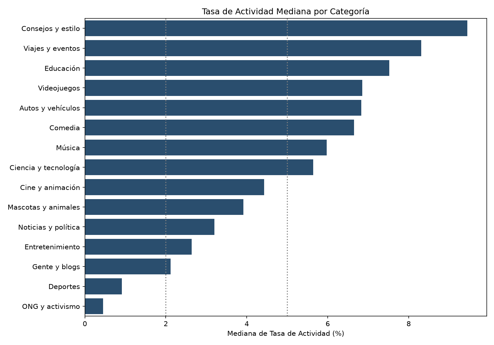
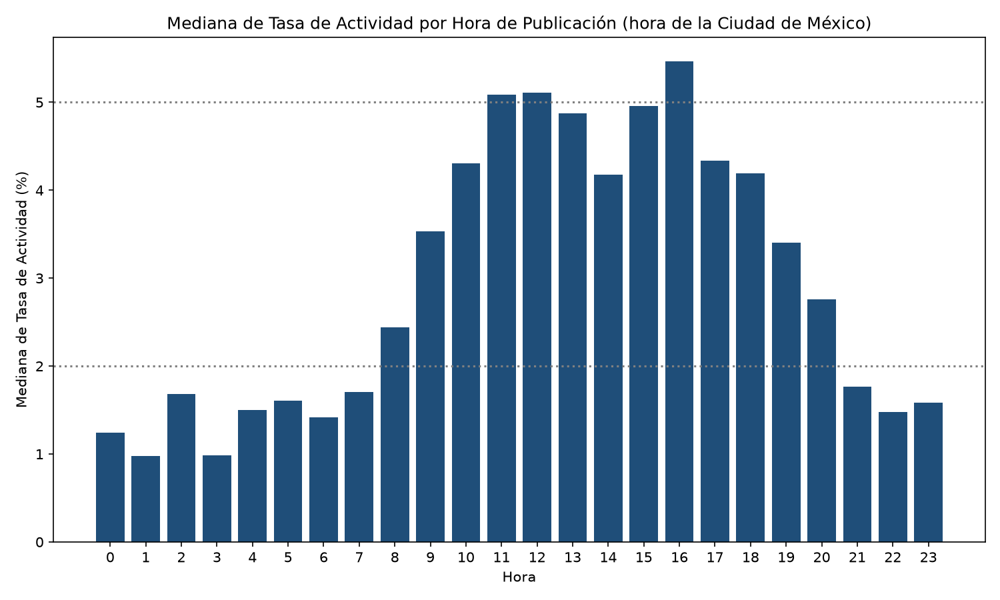
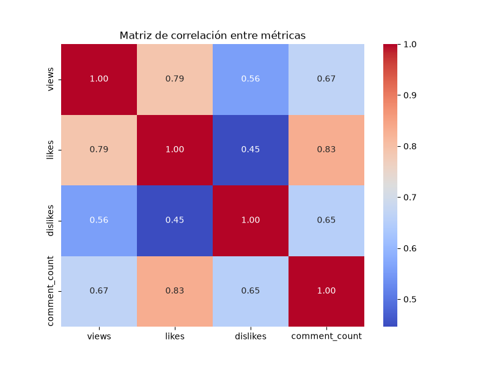

<div align="center">

# 📊 ¿Qué hace que un video en tendencia enganche?

### Análisis de engagement en videos en tendencia de YouTube México

*Categorías, horarios de publicación y métricas de interacción · noviembre 2017 – junio 2018*


-1F4E79)

[**Resumen**](#-resumen-en-30-segundos) ·
[**Hallazgos**](#-hallazgos) ·
[**Pipeline**](#-pipeline) ·
[**Cómo ejecutarlo**](#-cómo-ejecutarlo) ·
[**Reporte completo (PDF)**](docs/Reporte_Analisis_YouTube_Mexico.pdf)

</div>

---

## ⚡ Resumen en 30 segundos

| 📹 **40,402** | 🎬 **33,513** | 📅 **205** | 🗂️ **16** | 📈 **3.40 %** |
|:---:|:---:|:---:|:---:|:---:|
| registros analizados | videos únicos | días de tendencia | categorías | tasa de actividad mediana |

Este proyecto limpia, transforma y analiza los videos que llegaron a la lista de **tendencias de YouTube México** para responder una pregunta práctica: **¿qué categorías y qué horarios de publicación se asocian con más interacción de la audiencia?**

> [!IMPORTANT]
> **La categoría pesa más que el horario**, pero publicar entre las **12:00 y las 17:59 h (hora de la Ciudad de México)** se asocia con casi el **doble de interacción** que hacerlo por la noche, y con casi **cuatro veces** la de la madrugada.

---

## 📑 Contenido

- [🎯 Objetivo](#-objetivo)
- [🔄 Pipeline](#-pipeline)
- [📦 Datos](#-datos)
- [🧹 Transformaciones](#-transformaciones)
- [📐 Métricas](#-métricas)
- [🔎 Hallazgos](#-hallazgos)
- [📁 Estructura del repositorio](#-estructura-del-repositorio)
- [🚀 Cómo ejecutarlo](#-cómo-ejecutarlo)
- [🚧 Limitaciones](#-limitaciones)
- [🧭 Próximos pasos](#-próximos-pasos)

---

## 🎯 Objetivo

Responder cuatro preguntas sobre los videos en tendencia en México:

1. ¿Qué nivel de interacción tienen en general?
2. ¿Qué categorías generan más interacción y cuáles más rechazo?
3. ¿A qué hora conviene publicar?
4. ¿Cómo se relacionan vistas, likes, dislikes y comentarios?

---

## 🔄 Pipeline



| Paso | Script | Entrada | Salida |
|:---:|---|---|---|
| **1** | [`preprocessing.py`](src/preprocessing.py) | `data/raw/MXvideos.csv` | `data/processed/MXvideos_clean.csv` |
| **2** | [`metrics.py`](src/metrics.py) | `MXvideos_clean.csv` | `MXvideos_metrics.csv` + 3 resúmenes (`resumen_categoria`, `resumen_franja_horaria`, `resumen_hora`) |
| **3** | [`visualization.py`](src/visualization.py) | `MXvideos_metrics.csv` | 4 gráficas en `graficas/` |

---

## 📦 Datos

Videos que aparecieron en la lista de tendencias de YouTube México. Cada fila es **un video en un día de tendencia**, así que un mismo video puede aparecer varias veces. El archivo tiene el formato del dataset público [*Trending YouTube Video Statistics*](https://www.kaggle.com/datasets/datasnaek/youtube-new) de Kaggle.

| Concepto | Valor |
|---|--:|
| Filas en el archivo original | 40,451 |
| Duplicados exactos eliminados | 49 |
| **Filas analizadas** | **40,402** |
| Videos únicos (`video_id`) | 33,513 |
| Periodo en tendencia | 14 nov 2017 → 14 jun 2018 (205 días) |
| Categorías | 16 |

<details>
<summary><b>📖 Diccionario de columnas utilizadas</b></summary>

<br>

| Columna | Descripción |
|---|---|
| `video_id` | Identificador del video |
| `category_id` | Identificador numérico de la categoría (original) |
| `categoria` | Nombre de la categoría *(creada en este proyecto)* |
| `title` | Título del video (solo para revisar casos puntuales) |
| `publish_time` | Fecha y hora de publicación, **ya en hora de la Ciudad de México** |
| `hour` | Hora de publicación (0–23), hora local |
| `franja_horaria` | `madrugada` · `mañana` · `tarde` · `noche` *(creada)* |
| `views` · `likes` · `dislikes` · `comment_count` | Vistas, likes, dislikes y comentarios |
| `tasa_actividad` · `tasa_rechazo` · `ratio_comentarios` | Métricas calculadas *(ver [Métricas](#-métricas))* |

</details>

---

## 🧹 Transformaciones

| # | Transformación | Detalle |
|:---:|---|---|
| 1 | **Duplicados** | Se eliminan 49 filas idénticas |
| 2 | **Hora local** | `publish_time` viene en UTC; se convierte a `America/Mexico_City` con `tz_convert` |
| 3 | **Franjas horarias** | madrugada (0–5 h) · mañana (6–11 h) · tarde (12–17 h) · noche (18–23 h) |
| 4 | **Nombre de categoría** | Se mapea `category_id` → nombre con la clasificación estándar de YouTube |
| 5 | **Selección de columnas** | Se conservan solo las 11 columnas necesarias para el análisis |
| 6 | **Métricas** | Se calculan tasa de actividad, tasa de rechazo y ratio de comentarios |

> [!WARNING]
> **Detalle importante sobre la zona horaria.** La columna `publish_time` termina en `Z`, es decir, está en **UTC**. Quitar la zona con `tz_localize(None)` solo borra la etiqueta, **no convierte la hora**. Hay que usar `tz_convert`. México está 5 o 6 horas detrás de UTC según el horario de verano, y en este dataset **cambia el día de publicación en 34 % de los videos**.

| Hora en UTC (original) | Hora en la Ciudad de México (corregida) |
|---|---|
| 2017-11-13 06:06 &nbsp;→ `hour = 6` | 2017-11-13 **00:06** → `hour = 0` |
| 2017-11-13 05:11 &nbsp;→ `hour = 5` | 2017-11-**12 23:11** → `hour = 23` |
| 2017-11-13 17:00 &nbsp;→ `hour = 17` | 2017-11-13 **11:00** → `hour = 11` |

---

## 📐 Métricas

| Métrica | Fórmula | Cómo leerla |
|---|---|---|
| **Tasa de actividad** | `(likes + comentarios) / vistas × 100` | 🔴 < 2 % bajo · 🟡 2–5 % aceptable · 🟢 > 5 % excelente |
| **Tasa de rechazo** | `dislikes / vistas × 100` | 🟢 0–1 % muy bajo · 🟡 1–3 % moderado · 🟠 3–5 % alto · 🔴 > 5 % crítico |
| **Ratio de comentarios** | `comentarios / vistas × 1,000` | 🔴 0–2 bajo · 🟡 3–5 aceptable · 🟢 6–10 bueno · 🟢 > 10 excelente |

> [!NOTE]
> Todo el análisis usa la **mediana** y no la media. Las vistas tienen una asimetría de 22.9 y la media (340,175) es seis veces mayor que la mediana (56,793), porque unos pocos videos virales distorsionan el promedio.

<p align="center">
  
  <br><sub><b>Figura 1.</b> Distribución de vistas (escala logarítmica) con la mediana marcada.</sub>
</p>

---

## 🔎 Hallazgos

### 1️⃣ La interacción típica es aceptable, pero muy dispersa

La tasa de actividad mediana es **3.40 %**, pero los videos se concentran en los extremos y relativamente pocos quedan en el rango intermedio:

| Nivel | % de videos |
|---|---|
| 🔴 Bajo (< 2 %) | **40.8 %** `████░░░░░░` |
| 🟡 Aceptable (2–5 %) | **17.6 %** `██░░░░░░░░` |
| 🟢 Excelente (> 5 %) | **41.6 %** `████░░░░░░` |

### 2️⃣ La categoría es lo que más separa a los videos

<p align="center">
  
  <br><sub><b>Figura 2.</b> Tasa de actividad mediana por categoría. Las líneas punteadas marcan 2 % y 5 %.</sub>
</p>

| | Categoría | Tasa de actividad | Videos |
|:---:|---|--:|--:|
| 🥇 | Consejos y estilo | **9.45 %** | 2,466 |
| 🥈 | Viajes y eventos | **8.31 %** | 117 |
| 🥉 | Educación | **7.52 %** | 531 |
| ⋯ | Música | 5.98 % | 3,360 |
| ⋯ | Entretenimiento | 2.64 % | 13,474 |
| ⋯ | Gente y blogs | 2.12 % | 8,153 |
| ⬇️ | Deportes | **0.92 %** | 4,049 |
| ⬇️ | ONG y activismo | **0.45 %** | 252 |

- 💡 **Alta interacción con pocas vistas:** Consejos y estilo y Educación tienen audiencias pequeñas, pero muy participativas.
- 💡 **Muchas vistas, poca conversación:** Deportes tiene una mediana de 100,727 vistas y apenas 1.66 comentarios por cada 1,000.
- 💡 **Las dos categorías más grandes** (Entretenimiento y Gente y blogs, 53 % de la muestra) interactúan **por debajo** de la mediana global.

> La categoría *Shows* (3 videos) se excluye de las comparaciones por tener muy pocos datos.

### 3️⃣ Publicar entre las 12:00 y las 17:59 h se asocia con más interacción

<p align="center">
  
  <br><sub><b>Figura 3.</b> Tasa de actividad mediana por hora de publicación (hora de la Ciudad de México).</sub>
</p>

| Franja | Tasa de actividad mediana | | Videos |
|---|--:|---|--:|
| 🌙 Madrugada (0–5 h) | 1.25 % | `███░░░░░░░` | 2,966 |
| 🌅 Mañana (6–11 h) | 3.52 % | `███████░░░` | 7,135 |
| ☀️ **Tarde (12–17 h)** | **4.81 %** | `██████████` | 15,484 |
| 🌆 Noche (18–23 h) | 2.41 % | `█████░░░░░` | 14,817 |

El patrón se repite dentro de varias categorías (Entretenimiento, Gente y blogs, Música, Cine y animación), pero **no en todas**: en Noticias y política, Comedia y Consejos y estilo la noche iguala o supera a la tarde.

### 4️⃣ La tasa de rechazo casi no discrimina

En **98.7 %** de los videos es menor a 1 %, así que sirve poco para comparar videos en tendencia. Las medianas por categoría solo van de 0.04 % a 0.18 %.

### 5️⃣ Likes y comentarios van de la mano

<p align="center">
  
  <br><sub><b>Figura 4.</b> Correlación entre vistas, likes, dislikes y comentarios.</sub>
</p>

- Likes y comentarios son las variables más ligadas: **0.83** (Pearson) y **0.89** (Spearman).
- Los dislikes y las vistas pasan de **0.56** a **0.88** al cambiar de Pearson a Spearman. La relación es creciente, pero los valores extremos distorsionan la correlación lineal.

---

## 📁 Estructura del repositorio

```text
.
├── 📄 README.md
├── 📄 requirements.txt
├── 📁 src/
│   ├── preprocessing.py     # limpieza, hora local, franjas, categorías
│   ├── metrics.py           # métricas y resúmenes por categoría / franja / hora
│   └── visualization.py     # gráficas
├── 📁 data/
│   ├── raw/                 # coloca aquí MXvideos.csv
│   └── processed/           # se genera automáticamente
├── 📁 graficas/             # figuras del README (se regeneran al ejecutar)
└── 📁 docs/
    └── Reporte_Analisis_YouTube_Mexico.pdf
```

---

## 🚀 Cómo ejecutarlo

**1. Clona el repositorio e instala las dependencias**

```bash
git clone https://github.com/<tu-usuario>/<nombre-del-repo>.git
cd <nombre-del-repo>

python -m venv .venv
source .venv/bin/activate        # en Windows: .venv\Scripts\activate
pip install -r requirements.txt
```

**2. Descarga el dataset** desde [Kaggle](https://www.kaggle.com/datasets/datasnaek/youtube-new) y guarda `MXvideos.csv` en `data/raw/`.

**3. Ejecuta los tres scripts en orden, desde la raíz del proyecto**

```bash
python src/preprocessing.py     # → data/processed/MXvideos_clean.csv
python src/metrics.py           # → MXvideos_metrics.csv + resumen_*.csv
python src/visualization.py     # → graficas/*.png
```

> [!TIP]
> Si ya tenías archivos en `data/processed/` de una versión anterior, **bórralos** antes de empezar: sus horas estaban en UTC.

---

## 🚧 Limitaciones

- **Sesgo de selección:** solo se observan videos que llegaron a tendencias. Los que tuvieron poca interacción y nunca llegaron a la lista no están en los datos.
- **Videos repetidos:** 17 % de las filas son apariciones adicionales de un mismo video en otros días. Al deduplicar por `video_id`, la tasa de actividad mediana baja de 3.40 % a 3.30 % y el orden de las categorías se mantiene en lo esencial.
- **Calificaciones y comentarios desactivados:** 621 registros tienen las calificaciones desactivadas y 431 los comentarios, lo que reduce artificialmente sus métricas (1.5 % y 1.1 % de la muestra).
- **Sorteos:** varios de los videos con mayor tasa de actividad son sorteos, donde comentar o dar like es requisito para participar. Inflan las colas de la distribución.
- **Categorías pequeñas:** Viajes y eventos (117 videos), Mascotas (83) y Autos (252) tienen muestras reducidas y resultados menos estables.
- **Asociación, no causalidad:** no se sabe cuántas horas llevaba publicado cada video cuando se midió su tendencia, lo que puede explicar parte de la ventaja de la tarde.
- **Zona horaria:** se usa la hora de la Ciudad de México como aproximación del momento en que la audiencia vio el video.
- **Nombres de categoría:** el archivo solo trae el identificador numérico; los nombres provienen de la clasificación estándar de YouTube.

---

## 🧭 Próximos pasos

- [ ] Conservar `trending_date` para medir cuántos días tarda un video en llegar a tendencia y evitar contar el mismo video varias veces.
- [ ] Analizar las etiquetas (`tags`) y su variación entre 2017 y 2018.
- [ ] Agregar un análisis por día de la semana y por canal.
- [ ] Construir un modelo que controle categoría, hora y antigüedad del video a la vez.

---

## 📚 Reporte completo

El análisis completo, con todas las tablas, la discusión y las recomendaciones, está en [`docs/Reporte_Analisis_YouTube_Mexico.pdf`](docs/Reporte_Analisis_YouTube_Mexico.pdf).

<div align="center">

<sub>Hecho con 🐍 Python · pandas · matplotlib · seaborn</sub>

</div>
